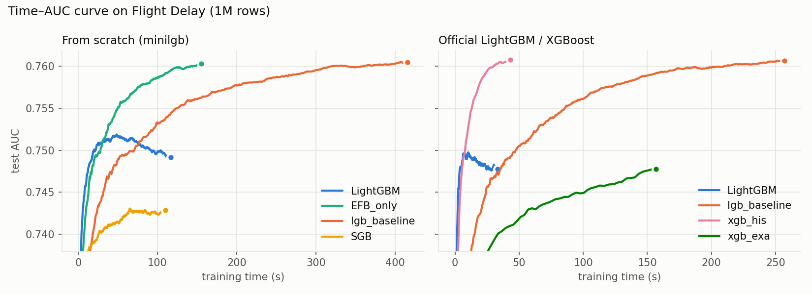
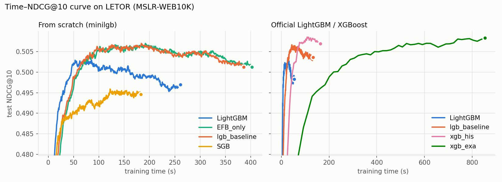
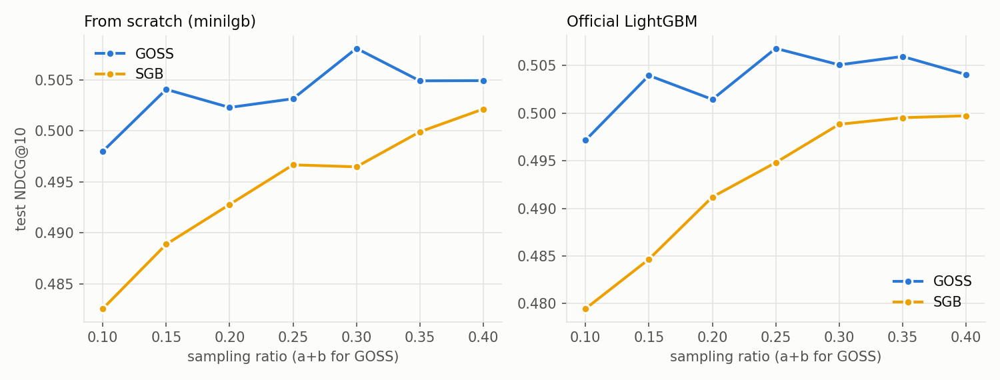
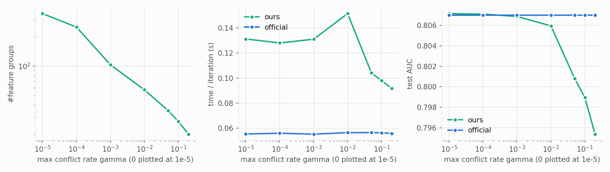
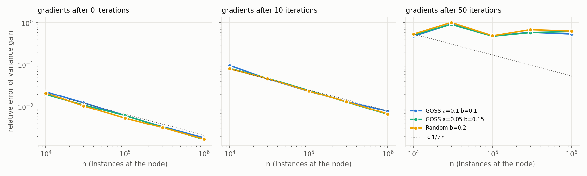

# Reproducing *LightGBM: A Highly Efficient Gradient Boosting Decision Tree* (NeurIPS 2017)

COMP3314 project: paper study and (bonus) experiment reproduction.

| | |
|---|---|
| **Paper** | Guolin Ke, Qi Meng, Thomas Finley, Taifeng Wang, Wei Chen, Weidong Ma, Qiwei Ye, Tie-Yan Liu. *LightGBM: A Highly Efficient Gradient Boosting Decision Tree.* Advances in Neural Information Processing Systems 30 (NeurIPS 2017), pp. 3146–3154. [PDF](https://papers.nips.cc/paper/6907-lightgbm-a-highly-efficient-gradient-boosting-decision-tree) |
| **Official code** | <https://github.com/microsoft/LightGBM> (C++; used here **only as a reference baseline**, never inside our implementation) |
| **This repo** | `minilgb/`: a **from-scratch** Python + Numba re-implementation of histogram GBDT with leaf-wise growth, **GOSS** and **EFB**, plus scripts that reproduce Tables 2–4 and Figures 1–2 at reduced scale on a 16 GB laptop |
| **Written analysis** | [`docs/analysis.md`](docs/analysis.md): problem, method, course connections, critical analysis |

---

## 1. Scope of the reproduction

| Paper item | Reproduced? | How |
|---|---|---|
| Alg. 1 histogram GBDT (leaf-wise, histogram subtraction, sparse-feature optimisation) | ✅ implemented | `minilgb/kernels.py`, `minilgb/booster.py` |
| Alg. 2 GOSS | ✅ implemented | `GBDT._sample` (`sampling="goss"`) |
| Alg. 3 greedy bundling (degree order and non-zero-count order), Alg. 4 merge | ✅ implemented | `minilgb/efb.py`, `minilgb/dataset.py` |
| Table 2 (time / iteration) and Table 3 (accuracy) | ✅ partial | Flight Delay (1M of the 10M rows) and LETOR (MSLR-WEB10K instead of WEB30K) |
| Fig. 1 / Fig. 2 time–accuracy curves | ✅ | same two datasets |
| Table 4 GOSS vs SGB at equal sampling ratio | ✅ | MSLR-WEB10K, early stopping on the validation split |
| Thm 3.2 (GOSS error bound) | ✅ empirical check | real gradients, error vs. n, GOSS vs. random sampling |
| EFB on KDD10 / KDD12, γ study (supplement) | ⚠️ substitute | a KDD-like synthetic dataset (300k × 66k sparse features); the real ones need more than 64 GB RAM |
| Allstate | ❌ | Kaggle login required; 12M × 4228 does not fit the memory budget |

**Hardware:** Intel i5-11400H (6 cores / 12 threads), 16 GB RAM, Windows 10. All methods use 6 threads.
**Paper:** 2 × Xeon E5-2670 v3, 256 GB RAM, 16 threads. Absolute times are therefore *not*
comparable; speed-up ratios and accuracy gaps are.

## 2. What is ours and what is reused

| Component | Origin |
|---|---|
| `minilgb/` (binning, EFB Alg. 3/4, dense and sparse histogram kernels, leaf-wise learner, GOSS/SGB, logloss and LambdaRank objectives, AUC/NDCG) | **written from scratch for this project** (NumPy + Numba), following only the paper |
| LambdaRank gradient details (truncation level 30, `lambdarank_norm` score-distance regularisation) | re-implemented from the description in LightGBM's `rank_objective.hpp`, so our ranking results are comparable with the official library |
| Hyper-parameters (`num_leaves=255`, `lr=0.1`, `min_sum_hessian_in_leaf=100`, `min_data_in_leaf=0`) | taken from LightGBM's public benchmark page, because the paper's supplement with the exact settings is not available |
| `lightgbm` 4.7, `xgboost` 3.4 Python packages | used **only** as reference baselines (`official_*`, `xgb_exa`, `xgb_his`) |
| `sklearn.datasets.load_svmlight_file` | parsing the MSLR text files |
| Data | Flight Delay: [szilard/benchm-ml](https://github.com/szilard/benchm-ml) (`train-1m.csv`, `test.csv`); MSLR-WEB10K: [Microsoft Research](https://www.microsoft.com/en-us/research/project/mslr/) (downloaded manually after accepting its licence) |

## 3. Implementation notes (`minilgb`)

* **Binning:** up to 255 equal-frequency bins per feature, built from a sample of 200k rows. For
  a non-negative feature, the value 0 always gets bin 0, so "bin 0" means "zero", which is what
  Alg. 4 relies on.
* **Storage:** each *group* (a single feature or an EFB bundle) is stored either as a dense
  `uint16` column or, when more than 80 % of its rows are in bin 0, as a sparse list of
  (row, bin) pairs.
  * The sparse lists are kept **ordered by leaf** during tree growth. These are the paper's
    "per-feature tables of non-zero data", whose maintenance cost is what EFB avoids.
  * Bin 0 of every feature is never accumulated: it is recovered as *leaf total − Σ other bins*.
    This makes both the sparse storage and the bundles **exact** when γ = 0. A unit test checks
    that EFB with γ = 0 learns bit-identical trees.
* **Tree learner:** leaf-wise (best-first) growth up to `num_leaves`. Only the smaller child's
  histogram is built; the larger one comes from subtraction. Leaf values are Newton steps
  −G/(H+λ).
* **GOSS (Alg. 2):** top `a·n` rows by |g|, plus `b·n` rows drawn at random from the rest with
  weight (1−a)/b.
  * Only the sampled rows are partitioned, and the sparse tables are filtered down to them.
  * Rows that were not sampled get their score update by traversing the tree on the binned data.
  * As in the paper, there is no warm-up phase (the official library skips GOSS for the first
    1/lr iterations; this is the option `goss_warmup`).
* **EFB (Alg. 3):** conflicts are counted *exactly* on all rows (n ≤ 1M), so γ = 0 really means
  zero conflicts. Two orderings are available: graph degree, and non-zero count (the cheap
  variant from the end of Sec. 4).

## 4. Setup and running

```bash
pip install -r requirements.txt          # numpy scipy pandas numba scikit-learn matplotlib lightgbm xgboost

# data: put files under data/raw/
#   data/raw/flight_train1m.csv  <- https://s3.amazonaws.com/benchm-ml--main/train-1m.csv
#   data/raw/flight_test.csv     <- https://s3.amazonaws.com/benchm-ml--main/test.csv
#   data/raw/MSLR-WEB10K/Fold1/{train,vali,test}.txt   (manual download, licence agreement)
python data/prepare_data.py              # one-hot Flight, convert MSLR to .npz (~15 min for MSLR)

python tests/test_correctness.py         # 5 sanity tests (EFB exactness, agreement with official LightGBM, ...)
bash run_all.sh                          # all experiments, sequentially (~4 h on 6 cores), resumable
python experiments/make_report.py        # -> results/RESULTS.md and results/figures/*.png
```

Individual experiments:

| Script | Reproduces |
|---|---|
| `experiments/exp_overall.py {flight,mslr}` | Table 2, Table 3, Fig. 1, Fig. 2 |
| `experiments/exp_table4.py` | Table 4, plus GOSS ablations |
| `experiments/exp_goss_theory.py` | empirical check of Theorem 3.2 |
| `experiments/exp_efb.py` | EFB speed and accuracy, bundling order, γ sweep |

## 5. Results

All numbers below come from `results/*.json` and are rebuilt by `python experiments/make_report.py`,
which writes the full tables to [`results/RESULTS.md`](results/RESULTS.md). All runs use 500
iterations, 6 threads and the same hyper-parameters for every method (§2). Times are means over
iterations; for our implementation, iteration 1 is excluded because it includes Numba JIT compilation.

### 5.1 Table 2: training time per iteration (s)

| Dataset | Source | xgb_exa | xgb_his | lgb_baseline | EFB_only | LightGBM (EFB+GOSS) | speed-up vs baseline |
|---|---|---|---|---|---|---|---|
| Flight Delay | paper (10M rows, 16 thr) | 5.94 | 1.05 | 1.39 | 0.27 | 0.22 | **6.3×** |
| Flight Delay (1M rows) | official libs | 0.313 | 0.085 | 0.513 | 0.053 | 0.066 | **7.8×** |
| Flight Delay (1M rows) | **ours** | – | – | 0.830 | 0.311 | 0.234 | **3.5×** |
| LETOR | paper (WEB30K, 16 thr) | 5.55 | 0.63 | 0.49 | 0.46 | 0.31 | **1.6×** |
| LETOR (WEB10K) | official libs | 1.703 | 0.313 | 0.266 | 0.225 | 0.108 | **2.5×** |
| LETOR (WEB10K) | **ours** | – | – | 0.772 | 0.804 | 0.521 | **1.5×** |

### 5.2 Table 3: test accuracy (AUC for Flight, NDCG@10 for LETOR; best test iteration, as in the paper)

| Dataset | Source | xgb_exa | xgb_his | lgb_baseline | SGB | LightGBM |
|---|---|---|---|---|---|---|
| Flight Delay | paper | 0.7601 | 0.7840 | 0.7847 | 0.7780 | 0.7846 |
| Flight Delay | official libs | 0.7477 | 0.7608 | 0.7607 | 0.7439 | 0.7497 |
| Flight Delay | **ours** | – | – | 0.7605 | 0.7431 | 0.7519 |
| LETOR | paper | 0.4977 | 0.4982 | 0.5277 | 0.5239 | 0.5275 |
| LETOR | official libs | 0.5083 | 0.5085 | 0.5066 | 0.4962 | 0.5033 |
| LETOR | **ours** | – | – | 0.5070 | 0.4959 | 0.5031 |

`RESULTS.md` also gives LETOR scores at the best *validation* iteration, which avoids selecting on
the test set. The ranking of the methods does not change.




### 5.3 Table 4: GOSS vs SGB at the same sampling ratio (LETOR, test NDCG@10, early stopping on validation)

| ratio | 0.10 | 0.15 | 0.20 | 0.25 | 0.30 | 0.35 | 0.40 |
|---|---|---|---|---|---|---|---|
| paper SGB / GOSS | .5182 / .5224 | .5216 / .5256 | .5239 / .5275 | .5249 / .5284 | .5252 / .5289 | .5263 / .5293 | .5267 / .5296 |
| **ours** SGB / GOSS | .4825 / **.4980** | .4889 / **.5041** | .4928 / **.5023** | .4967 / **.5031** | .4965 / **.5081** | .4999 / **.5049** | .5021 / **.5049** |
| official SGB / GOSS | .4795 / **.4972** | .4847 / **.5040** | .4912 / **.5014** | .4948 / **.5068** | .4988 / **.5051** | .4995 / **.5060** | .4997 / **.5041** |

Ablations at ratio 0.2 (ours):

| variant | NDCG@10 |
|---|---|
| no sampling | 0.5056 |
| GOSS a = 0.10, b = 0.10 | 0.5023 |
| GOSS a = 0.15, b = 0.05 | 0.5043 |
| GOSS a = 0.05, b = 0.15 | 0.5025 |
| GOSS without the (1−a)/b re-weighting | 0.4939 |
| SGB | 0.4928 |



### 5.4 EFB (synthetic KDD-like data: 300k × 68,264 sparse features, about 16 non-zeros per row)

| | #feature groups | time / iter (s) | test AUC |
|---|---|---|---|
| ours, no EFB | 48,935 | 0.434 | 0.80714 |
| ours, EFB with γ = 0 | **345** | **0.131** (3.3×) | 0.80714 (identical) |
| official, `enable_bundle=False` | – | 6.444 | 0.80700 |
| official, EFB | – | **0.057** (113×) | 0.80700 |

On the real data, EFB turns Flight's 657 one-hot features into **27** groups, with 0 conflicts.
It leaves MSLR's 136 dense features alone, so EFB gives no speed-up on LETOR, as in the paper
(0.49 → 0.46). Ordering Alg. 3 by non-zero count instead of graph degree gives 345 bundles
instead of 350, and is 17 % faster to bundle.

The γ sweep (max conflict rate) cuts the number of groups from 345 to 20. In our implementation
the time per iteration falls from 0.131 to 0.092 s, while AUC falls from 0.8071 to 0.7954.
Accuracy is essentially unchanged up to γ ≈ 10⁻³.



### 5.5 Theorem 3.2: an empirical check

For the root node, we compare the variance gain estimated on a 20 % sample with the gain on all
n rows, using real Flight gradients. Relative error (averaged over random draws):

| gradients after | n = 10k | 30k | 100k | 300k | 1M |
|---|---|---|---|---|---|
| 0 iterations: GOSS (.1,.1) / random | .023 / .021 | .013 / .011 | .006 / .005 | .0034 / .0032 | .0018 / .0017 |
| 10 iterations: GOSS (.1,.1) / random | .097 / .081 | .047 / .048 | .024 / .024 | .013 / .013 | .0079 / .0068 |
| 50 iterations: GOSS (.1,.1) / random | .49 / .54 | .93 / 1.02 | .49 / .50 | .60 / .69 | .55 / .64 |



### 5.6 Discussion: what is reproduced and what is not

**Reproduced**
* **EFB is the main source of the speed-up on sparse data, and it is lossless at γ = 0.**
  * On Flight it gives 2.7× (ours) and 9.6× (official) over the baseline; the paper reports 5.1×.
  * On the synthetic KDD-like data it gives 3.3× (ours) and 113× (official).
  * Accuracy is bit-identical in our implementation and to five decimals in the official one.
  * On dense LETOR it does nothing, as in the paper.
* **GOSS gives a further speed-up on LETOR, and in our implementation also on Flight.**
  * Flight: 0.311 → 0.234 s/iter (ours). In the official library GOSS is slightly *slower* than
    EFB alone at this size (0.053 → 0.066 s/iter): with EFB, an iteration is already so cheap
    that the cost of sampling dominates.
  * LETOR: 0.80 → 0.52 s/iter (ours) and 0.225 → 0.108 s/iter (official).
  * Combined with EFB, the speed-up over the baseline is 1.5–3.5× for us and 2.5–7.8× for the
    official library. The paper reports 1.6–6.3×.
* **GOSS beats SGB at every sampling ratio (Table 4), in both implementations.**
  * Our gap is larger than the paper's: +0.005 to +0.016 NDCG versus +0.003 to +0.004.
  * The ablation shows that the (1−a)/b re-weighting is essential. Without it, GOSS falls to the
    level of SGB, because the sample is biased.
* **Histogram + leaf-wise growth matches XGBoost's accuracy.** xgb_exa (exact, depth-wise) is
  slower than everything else.
* **Our implementation matches the official one closely:**
  * the same accuracy in every row of Table 3, to within 0.003;
  * the same Table 4 curve shape;
  * the same lossless behaviour of EFB.

  This is evidence that the algorithms are re-implemented faithfully from the paper.

**Not reproduced / discrepancies**
1. **GOSS costs some accuracy at our scale.**
   * Flight, 1M rows: −0.009 AUC (ours) and −0.011 (official).
   * LETOR: −0.004 NDCG.

   The paper reports no loss (0.7847 → 0.7846). Both implementations behave the same way, so this
   is not a bug. Theorem 3.2's error terms scale as 1/n_l, 1/n_r and 1/√n, so with 10× less data
   the deep leaves of a 255-leaf tree get noisy estimates. The official library also hides part
   of the loss with a warm-up that is not in the paper: it uses no GOSS for the first 1/lr
   iterations. We followed the paper and did not use it.
2. **Absolute accuracy differs from the paper.**
   * Flight: about 0.76 vs about 0.78 AUC. We train on 1M of the 10M rows and use our own one-hot
     encoding of the raw columns.
   * LETOR: about 0.507 vs about 0.528 NDCG@10. We use WEB10K, not WEB30K, and Fold 1 only.
   * The XGBoost baselines move the same way, so the comparison *between* methods is unaffected.
3. **Our absolute speed is 1.5–5× slower than the C++ library,** and our GOSS speed-up is
   smaller. We use Python orchestration and Numba kernels, and our sparse histograms do not use
   the multi-value-bin and row-wise layouts that LightGBM 4.x added after the paper. The
   *official_lgb_baseline* (LightGBM 4.x with GOSS and EFB turned off) is therefore a much
   stronger baseline than the paper's.
4. **Theorem 3.2: the 1/√n decay is confirmed, but GOSS is not more accurate than random sampling.**
   * After 0 and 10 iterations, the gain-estimation error of both samplers falls as 1/√n, as the
     theorem predicts.
   * At an equal ratio, the error of GOSS is **not** lower than random sampling's on these
     gradients. The theorem only promises an advantage when C_{a,b}² is small relative to the
     gradient spread, a condition the paper does not check on real data.
   * After 50 iterations the root split's true gain is almost zero (the model has already used
     it), so the *relative* error is O(1) for every sampler. The bound is absolute, and it is
     uninformative once the signal is this small.
   * Why GOSS still wins in Table 4 is therefore not fully explained by Theorem 3.2. The
     re-weighted focus on large-gradient (under-fitted) rows during the whole training run seems
     to matter more than the single-split estimation error.
5. **Official LightGBM ignores `max_conflict_rate` in our γ sweep** (time and AUC are constant).
   We passed the parameter to both `Dataset` and `train` but did not investigate why it had no
   effect. A likely reason is that LightGBM 4.x decides bundling on a sub-sample of rows and adds
   its own limits. The γ trade-off in §5.4 is therefore shown with our implementation only.
6. **Datasets not run:** Allstate (Kaggle login), KDD10 and KDD12 (they need far more than 16 GB
   of RAM to bin). The synthetic dataset stands in for them, and the size of its EFB effect is
   similar to the paper's (KDD10: 0.73 → 0.08 s/iter).

### 5.7 Challenges met during the reproduction
* **Making EFB exact.** Our first version counted conflicts on a 50k-row sample, which produced
  real conflicts at "γ = 0". Exact counting on all rows (sparse M·Mᵀ), and keeping
  very-dense features out of bundles, fixed it.
* **Making GOSS actually faster.** Sampling saves time only if *partitioning* and *sparse-table
  maintenance* also run on the sampled rows alone. Our first version only sampled the histogram
  step and was not faster at all.
* **LambdaRank parity.** Reaching the official NDCG required the score-distance normalisation
  that `lambdarank_norm` performs. The paper does not describe it.
* **Inconsistencies in the paper itself** (see `docs/analysis.md` §6.2):
  * the GOSS normaliser in Sec. 3.2 conflicts with Alg. 2;
  * Alg. 3 has an index typo;
  * Table 3 selects the best iteration on the test set;
  * the official code ranks rows by |g·h| instead of |g| and adds a warm-up phase.
* **16 GB RAM.**
  * We worked around it by using 1M-row Flight, WEB10K and a synthetic stand-in for KDD.
  * We freed datasets between runs, stored evaluation sets as float32, and made the pipeline
    resumable (`--skip-done`).

## 6. Acknowledgements

* Ke et al. (2017) and the LightGBM team, for the paper and the open-source reference implementation.
* The XGBoost developers, for the comparison baseline.
* Microsoft Research, for MSLR-WEB10K, and the szilard/benchm-ml project, for the Flight Delay splits.

The datasets keep their own licences and are not redistributed in this repository.
